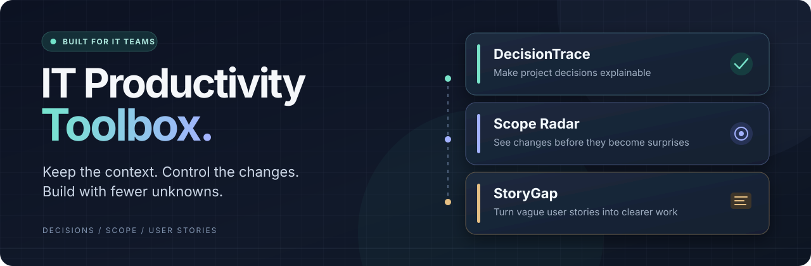

# IT Productivity Toolbox

**Conserver les raisons. Comprendre les changements. Préciser le travail.**

Trois outils open source pour les chefs de projet IT, Scrum Masters, Product Owners et Product Builders. Une application locale, sans compte obligatoire, serveur métier ni API payante.

[English README](README.md) · [Architecture](docs/ARCHITECTURE.md) · [Validation](docs/TESTING.md) · [Feuille de route](docs/ROADMAP.md)

L’interface associe des surfaces neutres et des accents indigo, en thèmes clair et sombre. L’accueil du projet présente les éléments à examiner et les mises à jour récentes. Actions contextuelles, cases à cocher pour les dépendances et filtres de revue simplifient les parcours. Les choix sont détaillés dans la [revue de conception et d’usage](docs/DESIGN_REVIEW.md) en anglais.

> **État : étape de développement locale fonctionnelle.** Les trois outils métier, Report Studio, Brand Studio, la traçabilité, les sauvegardes et l’interface anglais/français sont implémentés. Il n’y a pas de synchronisation cloud ni de démonstration hébergée publique annoncée. Consultez les [résultats de validation et limites](docs/HANDOFF.md).

## Trois outils complémentaires

| Outil             | Question traitée                                 | Parcours disponible                                                                                                                                                                          |
| ----------------- | ------------------------------------------------ | -------------------------------------------------------------------------------------------------------------------------------------------------------------------------------------------- |
| **DecisionTrace** | Pourquoi ce choix a-t-il été fait ?              | Contexte, alternatives, raisons, recherche et filtres, révisions motivées, historique, archivage, exports Markdown/JSON                                                                      |
| **Scope Radar**   | Qu’est-ce qui a changé depuis l’accord initial ? | Périmètre de référence figé et versionné, registre des changements, comparaison des livrables et estimations, simulation sans modifier les accords, exports                                  |
| **StoryGap**      | Que faut-il encore clarifier ?                   | Analyse locale de formulations anglaises/françaises, questions expliquées, notes modifiables et acceptables/ignorables, critères ajoutés explicitement, comparaison avec l’original, exports |

Les relations sont renseignées par l’utilisateur et navigables dans les deux sens. Une décision peut éclairer un changement, qui peut concerner une story. Une ressemblance de texte ne crée aucun lien automatiquement.

## Des analyses aux documents prêts à présenter

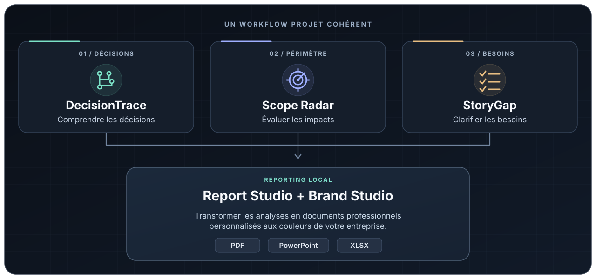

## Rapports et chartes graphiques

Report Studio réunit les données sélectionnées, leur provenance et le contexte de calcul. Il génère localement PDF, PowerPoint modifiable, XLSX, Markdown, CSV et JSON de rapport. Les sections vides sont omises, les estimations manquantes restent indisponibles et les simulations ne sont jamais approuvées par un export.

Brand Studio conserve plusieurs chartes par projet : logo PNG/JPEG/WebP contrôlé, couleurs avec HEX et sélecteur visuel, palette, contraste, trois rôles typographiques, en-tête/pied de page et cinq compositions de couverture. Les sauvegardes v2 conservent ces données ; les sauvegardes v1 restent importables.

[Guide utilisateur](docs/USER_GUIDE.md) · [Rapports et chartes](docs/REPORTING.md) · [Audit produit](docs/PRODUCT_AUDIT.md) · [Système de design](docs/DESIGN_SYSTEM.md) · [Internationalisation](docs/I18N.md) · [Validation actuelle](docs/VALIDATION.md)

## Votre espace, vos préférences


Les réglages proposent cinq palettes et un éditeur de thème pour l’accent, le fond de page, les cartes et le texte. Enregistrez jusqu’à 12 thèmes, vérifiez leur contraste et exportez/importez vos préférences. Choisissez le mode clair, sombre ou automatique ; les changements se synchronisent entre les onglets du même navigateur.

Adaptez la taille du texte de 100 % à 200 %, la police et la densité du contenu. Les options d’accessibilité comprennent le contraste élevé, l’espacement de lecture, les commandes agrandies, les liens soulignés, le focus clavier renforcé et la réduction des animations. Le réglage de réduction des animations de l’appareil reste respecté. Les projets et chartes de documents restent indépendants des préférences d’interface.

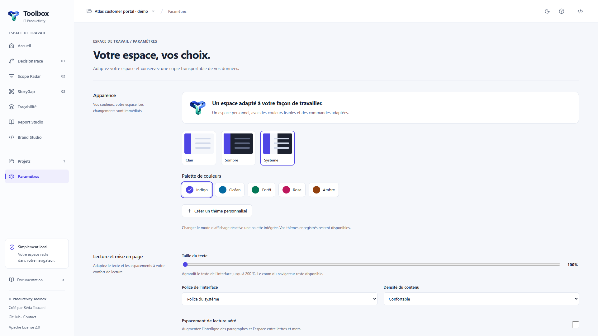

Réglages · Français · **1920 × 1080**. Consultez le [guide de personnalisation](docs/PERSONALIZATION.md) et les [sources et le prompt du logo](docs/BRANDING.md).

## Application Preview

Captures authentiques du build de production, données fictives Atlas, `deviceScaleFactor: 1`, sans capture pleine page ni recadrage. Le [manifeste](docs/assets/screenshots/manifest.json) conserve dimensions, langue, route et empreintes.

### Responsive — les 9 résolutions

**Ordinateur** — accueil · 1920 × 1080.

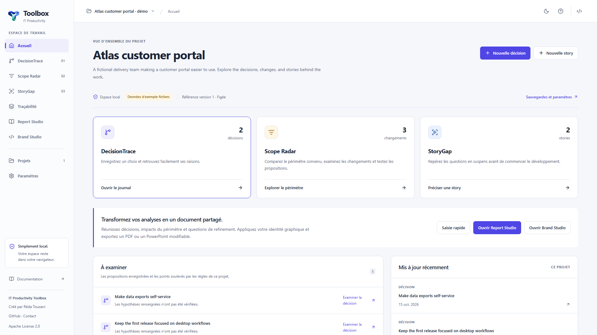

Accueil du projet · Français · **1920 × 1080**.

**Ultrawide** — accueil · 3440 × 1440.

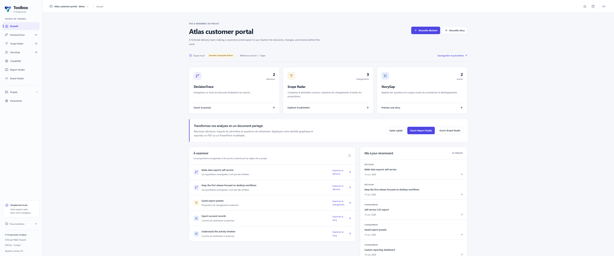

**Ordinateur portable** — accueil · 1440 × 900.

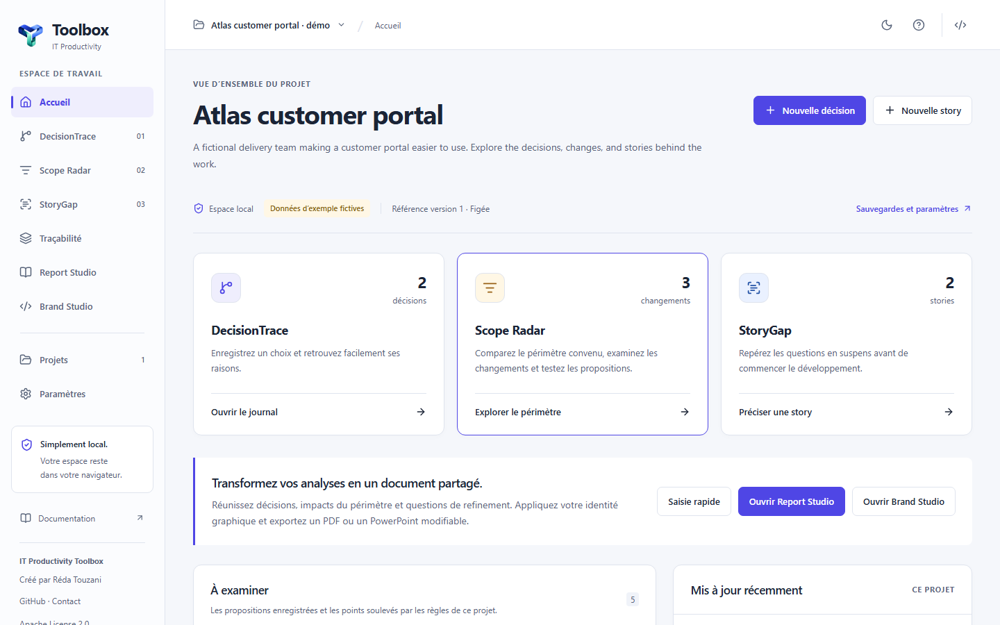

**Ordinateur compact** — accueil · 1366 × 768.

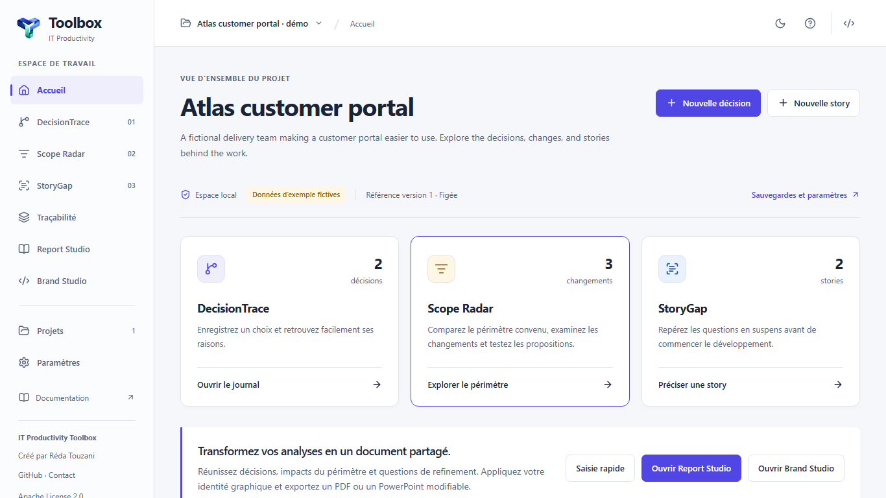

**Tablette** — accueil · 1024 × 768 et 768 × 1024.

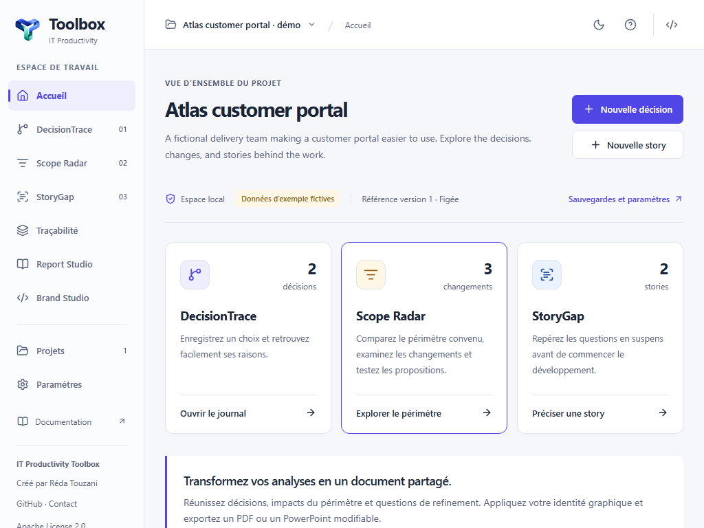
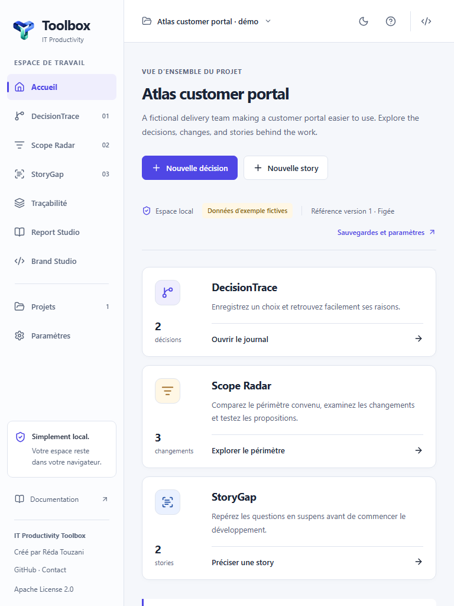

**Mobile** — accueil · 390 × 844, 360 × 800 et 430 × 932.

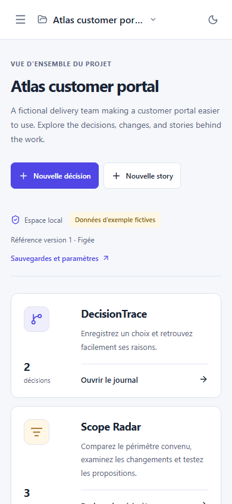
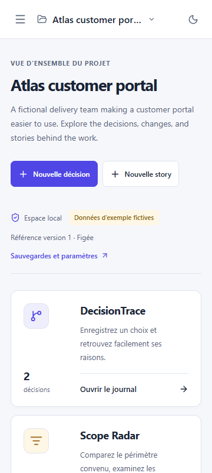
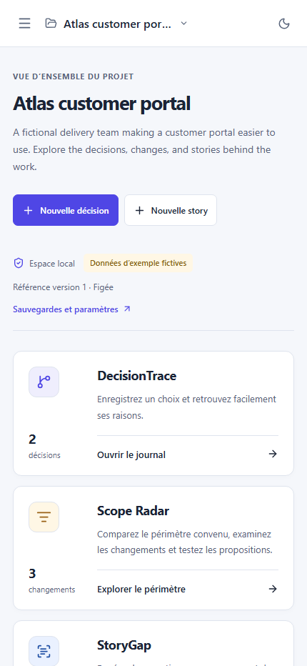

<details>
<summary>Les outils et les studios</summary>

Journal DecisionTrace · Français · 1920 × 1080.

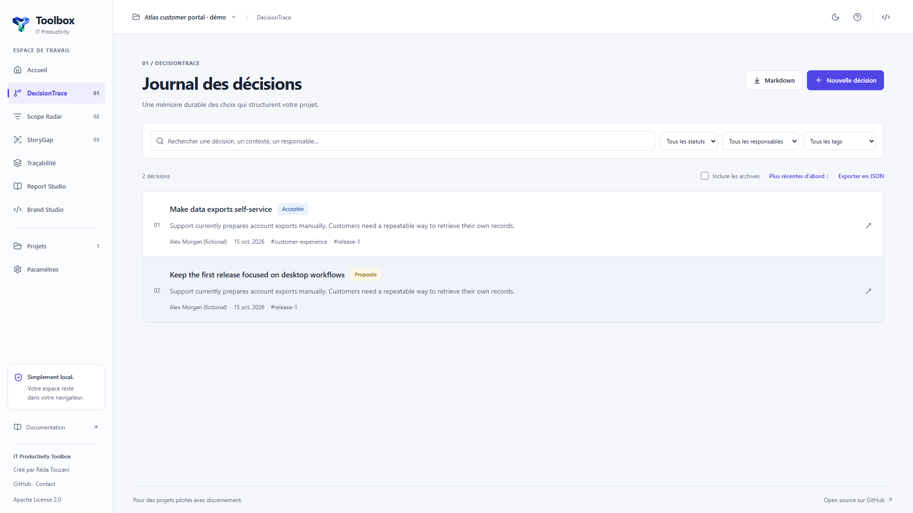

Analyse Scope Radar · Français · 1920 × 1080.

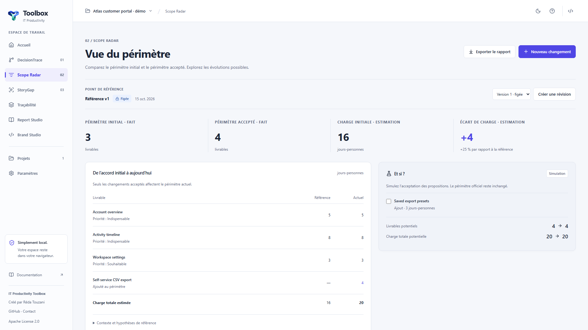

Analyse StoryGap · Français · 1920 × 1080.

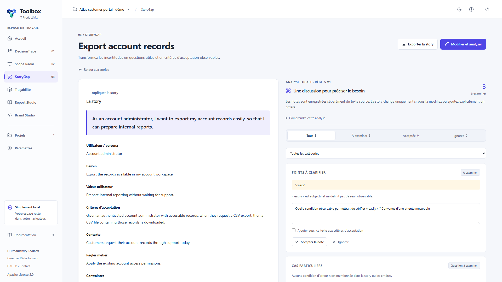

Report Studio · Français · 1920 × 1080.

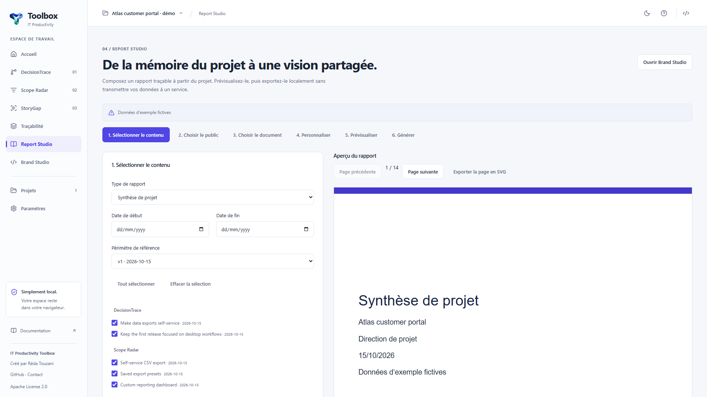

Brand Studio · Français · 1920 × 1080.

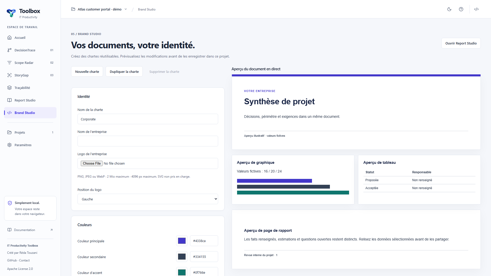

</details>

Exécuter `pnpm test:e2e` avant `pnpm screenshots` : les reçus responsive doivent correspondre au build courant.

## Essayer le produit

Avec **Node.js 24** et **pnpm 10.18.3** :

```sh
git clone https://github.com/hrmonic/it-productivity-toolbox.git
cd it-productivity-toolbox
corepack enable
pnpm install --frozen-lockfile
pnpm dev
```

Ouvrez l’adresse indiquée par Vite. Aucune clé API ni variable d’environnement n’est nécessaire. Dans **Settings → Application language**, choisissez **Français**.

Explorez le projet fictif Atlas : suivez la décision d’export jusqu’au changement accepté et à la story associée. Dans Scope Radar, l’estimation initiale fictive de 16 jours-personnes passe à 20 avec les changements acceptés ; les propositions sélectionnées modifient uniquement la simulation. Vous pouvez aussi créer un projet vierge.

## Des résultats explicables

Les statuts sont explicites et le périmètre initial nécessite une action pour être figé. Les versions précédentes sont conservées. Une estimation inconnue n’est jamais remplacée par zéro ; chaque référence utilise une seule unité et les pourcentages évitent la division par une référence nulle.

StoryGap utilise des règles déterministes, sans faux résultat IA ni score de qualité. Accepter une note ne prouve pas qu’une règle métier est validée ou qu’une story est prête. La discussion en équipe reste nécessaire.

## Données locales et sauvegardes

Les projets sont stockés dans IndexedDB, dans ce navigateur et à cette adresse. Il n’y a ni analyse d’usage ni traitement distant du contenu. Les données et sauvegardes JSON ne sont pas chiffrées. Le navigateur peut effacer ses données : conservez une sauvegarde hors du navigateur.

Les fichiers de sauvegarde complets sont validés, limités à 5 Mio et restaurés dans de nouvelles copies avec remappage des identifiants. Les projets existants sont conservés. Un export de rapport individuel n’est pas un fichier de restauration complet.

L’interface est bilingue. Le contenu des projets reste dans la langue de saisie et les données de démonstration sont en anglais. Les clés JSON restent stables ; les titres des rapports et exports lisibles suivent la langue choisie.

## Qualité et documentation

```sh
pnpm check
pnpm exec playwright install chromium
pnpm test:e2e
```

Le typage, le lint, le formatage, les tests, le build et les parcours navigateur sont vérifiables. Des contrôles d’accessibilité automatisés complètent la vérification clavier et mobile, sans constituer une certification complète. Les résultats précis sont documentés dans le [point de livraison](docs/HANDOFF.md).

Le code, les commentaires, les commits et la documentation technique sont en anglais. La stack repose sur React, TypeScript strict, Vite, Dexie, Zod, Radix et des règles métier séparées de l’interface.

[PRD et risques](docs/PRD.md) · [Architecture](docs/ARCHITECTURE.md) · [Modèle de données](docs/DATA_MODEL.md) · [Tests](docs/TESTING.md) · [Contribution](CONTRIBUTING.md)

Les limites actuelles comprennent l’absence de collaboration multi-utilisateur, de synchronisation, d’authentification, d’IA distante et d’hébergement public. La validation navigateur automatisée cible Chromium ; Firefox, WebKit et une revue complète avec technologies d’assistance restent à réaliser.

## Licence et auteur

Projet sous **[licence Apache 2.0](LICENSE)**, créé et maintenu par **[Réda Touzani (@hrmonic)](https://github.com/hrmonic)** · [dev@hrmonic.fr](mailto:dev@hrmonic.fr).
