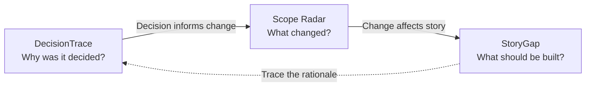

  

<h1 align="center">IT Productivity Toolbox</h1>

  <strong>Open-source productivity tools for IT project managers, Scrum Masters, Product Owners and Product Builders.</strong> 
  Preserve project decisions. Understand scope changes. Write clearer user stories.

  <a href="README.fr.md">Lire en français</a> ·
  <a href="#explore-the-toolbox">Explore the tools</a> ·
  <a href="#how-the-tools-work-together">Connected workflow</a> ·
  <a href="#roadmap">Roadmap</a> ·
  <a href="#frequently-asked-questions">FAQ</a>

  
  
  

> **Project status — October 2026:** IT Productivity Toolbox is in its **design and planning stage**. The three tools below describe the intended product, **not features currently available for use**. This repository currently contains the project presentation and Apache 2.0 license. A runnable application, live demo, installation guide and performance claims will be added only after they can be verified.

## At a glance

**IT Productivity Toolbox** is a planned, lightweight collection of connected yet independently useful web applications for day-to-day IT project management and product delivery. Its first three modules address recurring problems: losing the reasoning behind decisions, losing sight of project scope changes, and starting development with ambiguous user stories.

| | |
| --- | --- |
| **For** | IT Project Managers, Scrum Masters, Product Owners, Product Builders and delivery teams |
| **Purpose** | Improve decision traceability, scope change visibility and user story clarity |
| **Initial modules** | DecisionTrace, Scope Radar, StoryGap |
| **Product approach** | Focused tools, explainable results, optional cross-tool traceability |
| **Planned experience** | Browser-based, local-first, no mandatory account, French and English |
| **Current availability** | Concept and roadmap; application not released |

### Why build another productivity toolkit?

General-purpose project management platforms are powerful, but small, recurring problems can still be difficult to solve quickly:

- **“Why did we decide this?”** Context and trade-offs disappear across meetings, chat threads and documents.
- **“What changed since the original agreement?”** New requests accumulate without a clear view of their effect on the project baseline.
- **“Is this story ready to discuss with the team?”** Vague requirements lead to unresolved questions and untestable acceptance criteria.

The intention is **not to replace Jira, Trello, Notion or an agile planning platform**. It is to provide focused companions that help teams reason about their work and document the answers.

## Explore the toolbox

### 01 / DecisionTrace — Project decision log and rationale

**Capture not just what was decided, but why.**

DecisionTrace is designed to help project managers and Product Owners maintain a searchable record of project and product decisions.

**Planned capabilities**

- Record the decision, its context, owner, stakeholders and date.
- Document alternatives, trade-offs, assumptions and rationale.
- Track decision states and meaningful revisions.
- Connect decisions to scope changes and user stories.
- Search and filter decision history; export records for documentation.

**Example:** A team chooses a search strategy. Weeks later, DecisionTrace helps explain the original trade-offs before that decision is revisited.

**Best suited to:** IT Project Managers · Product Owners · Technical Leads

### 02 / Scope Radar — Scope creep and change impact tracking

**Know what changed between the agreed baseline and today's scope.**

Scope Radar is designed to make scope evolution visible without pretending that missing estimates are known.

**Planned capabilities**

- Define and version an agreed project baseline.
- Capture proposed, accepted and rejected change requests.
- Compare the baseline with the current accepted scope.
- Highlight affected deliverables, dependencies and known risks.
- Explore *what-if* scenarios without modifying approved project data.
- Export structured change registers and scope summaries.

**Important principle:** Effort or schedule impact must be calculated only from supplied, compatible data. Unavailable information must be identified, not invented.

**Best suited to:** IT Project Managers · Product Owners · Delivery Leads

### 03 / StoryGap — User story analysis and acceptance criteria

**Make requirements clearer before implementation starts.**

StoryGap is designed to help Product Owners, Scrum Masters and Product Builders find ambiguity, missing edge cases and acceptance criteria that cannot yet be verified.

**Planned capabilities**

- Enter or paste user stories and their context.
- Flag unclear language, missing information and open questions.
- Suggest review points for business rules and edge cases.
- Help draft testable acceptance scenarios, including Given / When / Then.
- Let users accept, edit or dismiss each suggestion.
- Compare revisions and export refined stories.

**Important principle:** StoryGap should ask for missing business rules rather than invent them. Its initial analysis is planned around transparent rules and heuristics, not a simulated or mandatory AI service.

**Best suited to:** Product Owners · Scrum Masters · Product Builders · Developers

## How the tools work together

Each tool is intended to solve a useful problem on its own. A shared **project traceability** layer will also allow teams to connect related information when needed.

**Example workflow:** A product decision creates a change request. That request affects two user stories. Instead of keeping three isolated records, the planned toolkit will help a team navigate from the decision to the change and the affected requirements.

The traceability model will rely on **explicit, user-validated links**. It will not assume causality from similar wording.

## Designed for focused, trustworthy work

The product is being planned around the following commitments:

| Principle | Intended behavior |
| --- | --- |
| **Start quickly** | Explore focused tools without a mandatory account |
| **Keep control of your data** | Local-first storage, with backup and export planned |
| **Explain the result** | Show assumptions, calculations and reasons behind warnings |
| **Respect the source of truth** | Do not silently rewrite approved baselines or decisions |
| **Support two languages** | English and French interfaces and documentation |
| **Make tools work together** | Connect decisions, changes and stories without forcing a single workflow |
| **Build for accessibility** | Responsive layouts, keyboard navigation and accessible feedback |

These are **product goals**, not claims that the implementation or its security has already been audited.

## Intended architecture

The initial technical direction is **React, TypeScript and Vite**, with modular feature boundaries and browser-based persistence using **IndexedDB / Dexie**. Other planned components include **Zod** for validation, **react-i18next** for localization, **Vitest** for unit tests and **Playwright** for end-to-end testing.

These choices are subject to validation during development. No production-ready architecture, CI pipeline, test coverage or deployed instance is claimed at this stage.

The first version is intended to work without a paid API or mandatory remote AI provider. If AI-assisted analysis is introduced later, sending project content to third parties must require informed user control.

## Roadmap

- [ ] **Foundation** — Shared interface, project workspace, persistence and EN/FR localization
- [ ] **DecisionTrace** — Decisions, alternatives, revision history, search and export
- [ ] **Scope Radar** — Project baselines, change log, comparisons and what-if analysis
- [ ] **StoryGap** — Rule-based story analysis, editable suggestions and acceptance criteria
- [ ] **Cross-tool traceability** — Links among decisions, scope changes and stories
- [ ] **Quality and release** — Automated tests, accessibility review, documentation and verified demo

The roadmap communicates intent rather than delivery dates. Scope and ordering may evolve with user feedback.

## Getting started

**The application has not been released yet.** There are no installation commands or public demo to follow at this time.

You can currently:

1. Read the [product overview](#at-a-glance) and [planned modules](#explore-the-toolbox).
2. Review the [roadmap](#roadmap).
3. [Open an issue](https://github.com/hrmonic/it-productivity-toolbox/issues) to share a recurring IT workflow problem, feature idea or usability need.
4. Watch the repository for future implementation updates.

Installation and development instructions will be published once working code is available.

## Frequently asked questions

### What is IT Productivity Toolbox?

IT Productivity Toolbox is an open-source project for small, purpose-built tools that support IT project managers, Scrum Masters, Product Owners and Product Builders. Its initial focus is decision documentation, scope change analysis and user story refinement.

### How can I document technical or product decisions?

The planned **DecisionTrace** module will help capture decisions together with their context, alternatives, responsible people and downstream links, creating a searchable decision log.

### How can I identify project scope creep?

The planned **Scope Radar** module will compare an agreed project baseline with accepted changes and surface their effects on deliverables, effort estimates and dependencies when reliable input data is available.

### How can I improve ambiguous user stories?

The planned **StoryGap** module will review story wording and acceptance criteria, identify unanswered questions and offer suggestions that users can validate or edit.

### Does the toolkit require AI, an account or cloud hosting?

The intended first version is local-first and does not require a paid AI API or mandatory account. This behavior will be verified when the application is implemented.

### Is it available in French?

The project is planned to support **English and French**. The French-language project presentation is available in [README.fr.md](README.fr.md).

### Is the project ready to use?

**Not yet.** This repository currently publishes the product direction and license. Functional releases will be identified explicitly when available.

## Contributing and feedback

The most useful early contributions are **concrete examples of frustrating, repetitive tasks in IT delivery**.

When proposing an idea through [GitHub Issues](https://github.com/hrmonic/it-productivity-toolbox/issues), it helps to describe:

- The role and situation in which the problem occurs.
- What you do today, and where the friction appears.
- What a successful solution would produce.
- Any privacy, accessibility or workflow constraints.

Code contribution guidance will follow when the first implementation is available.

## License

Licensed under the **[Apache License, Version 2.0](LICENSE)**. The license permits use, modification and distribution under its terms, including commercial use.

## Maintainer

Created and maintained by **[Réda Touzani (@hrmonic)](https://github.com/hrmonic)** — bridging business needs, product thinking and software engineering.

---

**Less context lost. Fewer surprises. Clearer work.**

[Back to top](#it-productivity-toolbox) · [Version française](README.fr.md)
