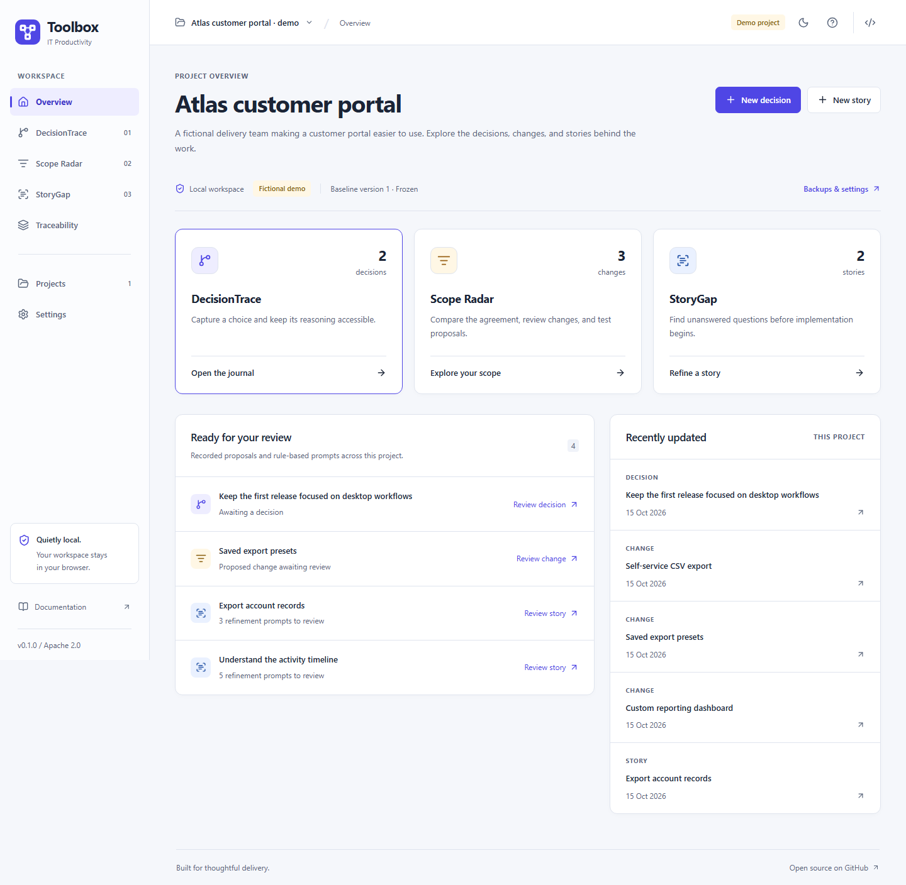
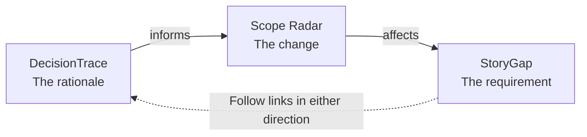
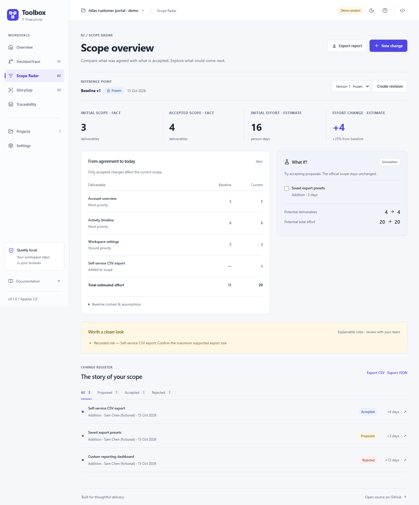
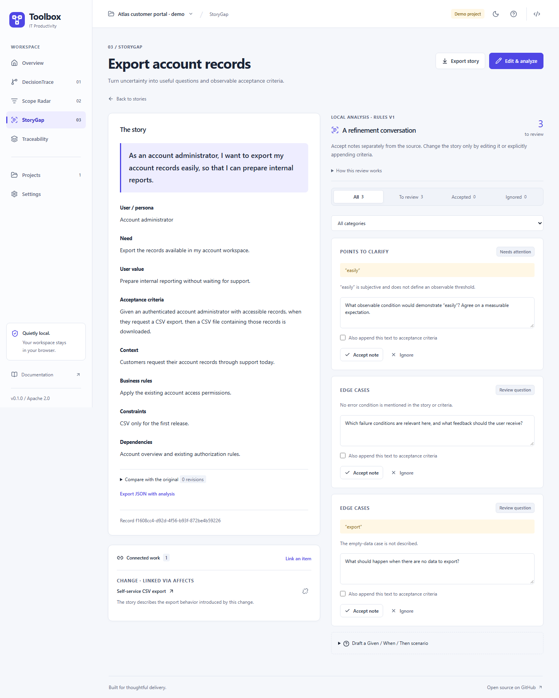
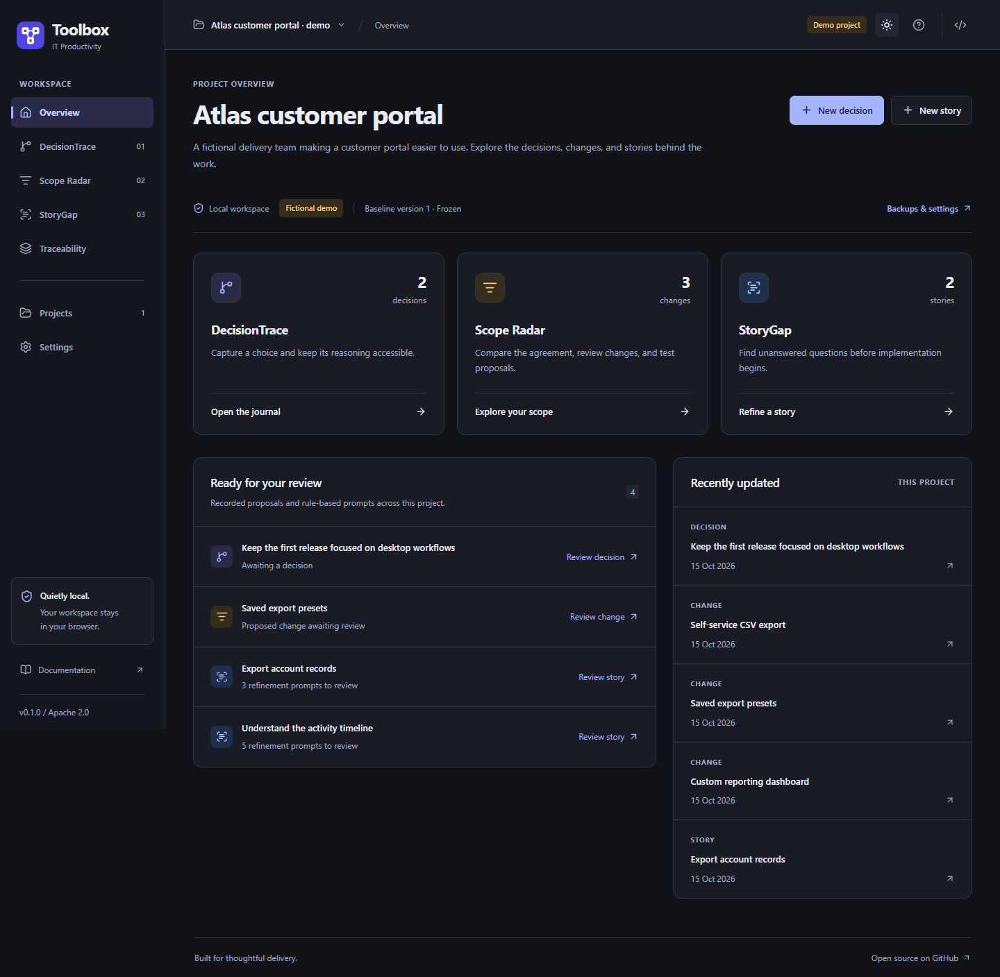

# IT Productivity Toolbox

**Keep the why. Understand the change. Clarify the work.**

Three connected, independently useful tools for IT Project Managers, Scrum Masters, Product Owners, and Product Builders. A local-first web application with no mandatory account, backend, or paid API.

[Getting started](#run-locally) · [Explore the tools](#three-tools-one-project-memory) · [Architecture](docs/ARCHITECTURE.md) · [Quality checks](docs/TESTING.md) · [Version française](README.fr.md)

The interface uses a neutral/indigo identity with light and dark themes. The project overview surfaces real review items and recent work; contextual actions, searchable dependency checkboxes and story review filters keep routine tasks direct. See the [design review and UX decisions](docs/DESIGN_REVIEW.md).



> **Status: functional 0.1 foundation.** DecisionTrace, Scope Radar, StoryGap, project traceability, backups, and English/French interfaces are implemented. This is a browser-local application: there is no cloud synchronization, account service, or public hosted demo announced here. See the [validation record and known boundaries](docs/HANDOFF.md).

## Three tools, one project memory

| Tool              | The question it helps answer            | What you can do                                                                                                                                                                            |
| ----------------- | --------------------------------------- | ------------------------------------------------------------------------------------------------------------------------------------------------------------------------------------------ |
| **DecisionTrace** | Why did we decide this?                 | Record context, alternatives and rationale; search/filter the journal; revise with a reason; inspect history; archive; export Markdown/JSON                                                |
| **Scope Radar**   | What changed since we agreed the scope? | Freeze a baseline; record proposed, accepted and rejected changes; compare deliverables and compatible effort estimates; simulate proposals; export reports and registers                  |
| **StoryGap**      | What still needs to be clarified?       | Analyze English/French stories with local rules; review ambiguity and missing cases; edit, accept or ignore notes; explicitly append confirmed criteria; compare with the original; export |

A project decision can **inform** a scope change; that change can **affect** a user story. Typed links are created by the user, shown on both records, and collected in a traceability view. Similar wording never creates an assumed relationship.



The toolbox complements your delivery workflow. It does not try to replace Jira, Trello, Notion, or a full project-management platform.

## Try a complete workflow in a few minutes

1. Start the application and choose **Explore the demo**. Atlas is a clearly labelled, entirely fictional customer portal project.
2. Open **DecisionTrace → Make data exports self-service**. Read the alternatives and rationale, then follow its link to the accepted CSV export change.
3. In **Scope Radar**, compare the 16-person-day fictional baseline with 20 accepted person-days. Select **Saved export presets** in the what-if panel: the simulated total changes, while the official total remains unchanged.
4. Open the linked export story in **StoryGap**. Review a prompt, edit its note, and accept or ignore it. The original story is retained.
5. Visit **Settings** to export a full JSON backup. Restoration validates the file and creates separate copies with remapped references.

You can instead create a blank project. Projects are isolated. The demo can be reset or deleted without removing other projects.

## Run locally

**Requirements:** Node.js 24 and pnpm 10.18.3, as declared in the repository.

```sh
git clone https://github.com/hrmonic/it-productivity-toolbox.git
cd it-productivity-toolbox
corepack enable
pnpm install --frozen-lockfile
pnpm dev
```

Open the URL printed by Vite. No environment variables, API keys, accounts, or server-side database are needed.

```sh
pnpm build       # TypeScript check and static production bundle
pnpm preview     # Inspect that bundle locally
```

Static hosting guidance and origin-specific storage caveats are in [Deployment](docs/DEPLOYMENT.md). The CI workflow checks the application; it does not deploy it.

## Designed to explain its results

- **Approval stays explicit.** Saving a decision does not accept it. Baselines require a separate freeze action. Accepted/rejected changes are immutable ledger entries.
- **Unknown stays unknown.** Missing effort is not zero. Each baseline uses a single unit. Percentages are unavailable when the initial estimate is zero or required inputs are missing.
- **Simulation stays separate.** Selecting proposals derives a potential scope; it does not change accepted project records.
- **Suggestions stay under your control.** StoryGap provides deterministic review prompts, not AI output or a readiness score. INVEST requires a team conversation.
- **History stays useful.** Decision revisions retain the previous content and explanation. Story revisions retain the original and earlier content. Baseline revisions preserve earlier agreements.

See the [data model and calculation contract](docs/DATA_MODEL.md) for the exact rules and trade-offs.

## Your data stays in this browser

Projects are stored in **IndexedDB through Dexie**, scoped to the current browser and origin. There are no analytics, remote analysis calls, runtime font CDNs, or cloud synchronization. Following an external documentation link opens that website.

**Keep backups.** Clearing site data, browser eviction, or changing the application address can make local records unavailable. IndexedDB and downloaded JSON files are **not encrypted**. Apply your organization's information-handling policy before recording sensitive content.

Full backups include histories, baseline versions, changes, stories and links. Imports are limited to 5 MiB and checked for schema and reference integrity before an atomic restore. Existing projects are preserved. Individual report exports are not full restore files.

## A deliberately small architecture

**React 19 · strict TypeScript · Vite 8 · React Router · Dexie · Zod · Radix Dialog · Lucide**

Feature rules, presentation, and storage have separate responsibilities. Native forms and centralized CSS tokens keep the dependency surface focused. Vitest/Testing Library cover domain and component behavior; Playwright/axe exercise real browser journeys and selected accessibility rules.

```text
src/app/                    Application shell, projects, preferences and settings
src/features/decision-trace/ Decision journal, editor, history and rules
src/features/scope-radar/    Baselines, change ledger, calculations and simulation
src/features/story-gap/      Story refinement and deterministic analysis
src/features/traceability/   Typed links and bidirectional navigation
src/shared/                 UI primitives, schemas, data boundary and localization
```

The [architecture document](docs/ARCHITECTURE.md) explains the decisions, alternatives and costs. The [PRD](docs/PRD.md) connects features to user needs, acceptance evidence and delivery risks.

## Quality you can inspect

```sh
pnpm check
pnpm exec playwright install chromium
pnpm test:e2e
```

`pnpm check` runs typechecking, lint, formatting checks, unit/component tests and the production build. Browser tests exercise the critical workflows, persistence, restoration, English/French behavior, keyboard focus, mobile navigation, themes and automated accessibility checks. GitHub Actions runs the required checks without `continue-on-error`.

Read [Testing](docs/TESTING.md) and the completed CI runs for actual evidence. No unmeasured coverage percentage, Lighthouse score, complete accessibility certification, or independent security audit is claimed.

<details>
<summary>More authentic screenshots</summary>

### Scope comparison and what-if analysis



### Story refinement



### Dark theme



</details>

Screenshots come from the production build using the optional fictional dataset. Regenerate them with `pnpm screenshots`.

## Languages and current limits

The interface is available in **English and French** through Settings. Story rules recognize selected English and French formulations. Project content is never translated automatically; demo records remain in English. Export field names and report headings stay in English for interoperability.

The first release has no multi-user collaboration, authentication, encryption, external integrations, schedule predictions, or remote AI. Automated browser validation currently targets Chromium. Draft baselines and proposed changes do not have their own edit histories. Large-workspace performance and a full assistive-technology audit remain future work.

See the [roadmap](docs/ROADMAP.md) for prioritized next work rather than promised dates.

## Contribute or discuss a workflow

Concrete examples of lost decision context, hard-to-explain scope changes, or ambiguous requirements are especially useful. Describe the role, situation, current workaround, and desired outcome in a [GitHub issue](https://github.com/hrmonic/it-productivity-toolbox/issues), using fictional or anonymized content.

[Contribution guide](CONTRIBUTING.md) · [Security policy](SECURITY.md) · [Development handoff](docs/HANDOFF.md)

## License and maintainer

Licensed under the **[Apache License, Version 2.0](LICENSE)**.

Created and maintained by **[Réda Touzani (@hrmonic)](https://github.com/hrmonic)** — connecting business needs, product decisions, and maintainable software.
