# IT Productivity Toolbox

**Keep the why. Understand the change. Clarify the work.**

Three connected, independently useful tools for IT Project Managers, Scrum Masters, Product Owners, and Product Builders. A local-first web application with no mandatory account, backend, or paid API.

[Getting started](#run-locally) · [Explore the tools](#three-tools-one-project-memory) · [Architecture](docs/ARCHITECTURE.md) · [Quality checks](docs/TESTING.md) · [Version française](README.fr.md)

The interface uses a neutral/indigo identity with light and dark themes. The project overview surfaces real review items and recent work; contextual actions, searchable dependency checkboxes and story review filters keep routine tasks direct. See the [design review and UX decisions](docs/DESIGN_REVIEW.md).

> **Status: functional local development checkpoint.** DecisionTrace, Scope Radar, StoryGap, Report Studio, Brand Studio, traceability, backups, and English/French interfaces are implemented. This is a browser-local application: there is no cloud synchronization, account service, or public hosted demo announced here. See the [validation record and known boundaries](docs/HANDOFF.md).

## Three tools, one project memory

| Tool              | The question it helps answer            | What you can do                                                                                                                                                                            |
| ----------------- | --------------------------------------- | ------------------------------------------------------------------------------------------------------------------------------------------------------------------------------------------ |
| **DecisionTrace** | Why did we decide this?                 | Record context, alternatives and rationale; search/filter the journal; revise with a reason; inspect history; archive; export Markdown/JSON                                                |
| **Scope Radar**   | What changed since we agreed the scope? | Freeze a baseline; record proposed, accepted and rejected changes; compare deliverables and compatible effort estimates; simulate proposals; export reports and registers                  |
| **StoryGap**      | What still needs to be clarified?       | Analyze English/French stories with local rules; review ambiguity and missing cases; edit, accept or ignore notes; explicitly append confirmed criteria; compare with the original; export |

A project decision can **inform** a scope change; that change can **affect** a user story. Typed links are created by the user, shown on both records, and collected in a traceability view. Similar wording never creates an assumed relationship.

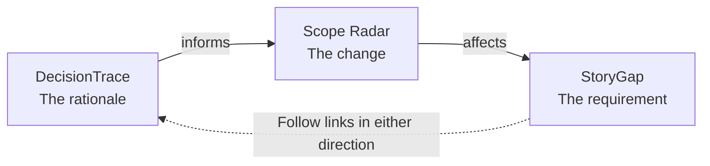

The toolbox complements your delivery workflow. It does not try to replace Jira, Trello, Notion, or a full project-management platform.

## From project analysis to team-ready deliverables

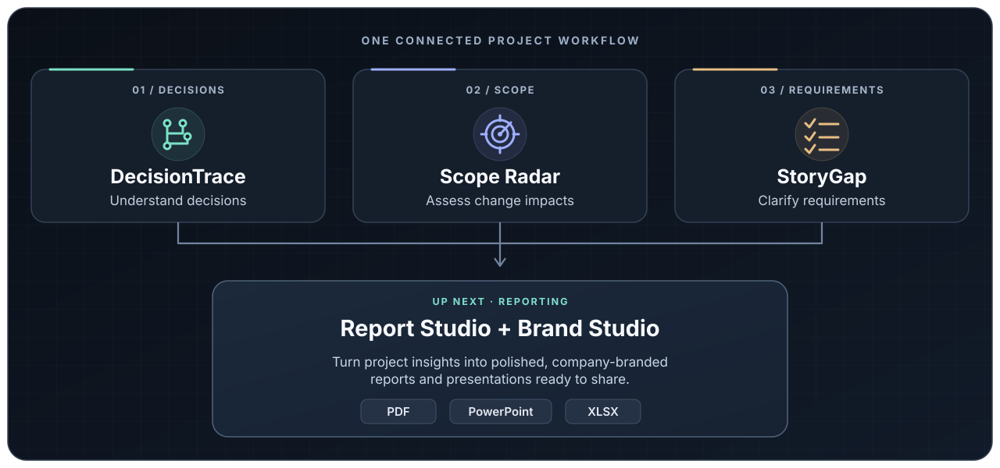

**Available today:** DecisionTrace, Scope Radar, StoryGap, Report Studio and Brand Studio. Create local PDF reports, editable PowerPoint presentations and XLSX workbooks from project analyses, with a configurable company identity.

## Try a complete workflow in a few minutes

1. Start the application and choose **Explore the demo**. Atlas is a clearly labelled, entirely fictional customer portal project.
2. Open **DecisionTrace → Make data exports self-service**. Read the alternatives and rationale, then follow its link to the accepted CSV export change.
3. In **Scope Radar**, compare the 16-person-day fictional baseline with 20 accepted person-days. Select **Saved export presets** in the what-if panel: the simulated total changes, while the official total remains unchanged.
4. Open the linked export story in **StoryGap**. Review a prompt, edit its note, and accept or ignore it. The original story is retained.
5. Open **Report Studio**, choose records, audience, format and brand profile, preview the result, then download PDF, editable PowerPoint, XLSX, Markdown, CSV or report-model JSON. **Brand Studio** saves project-scoped logos, colors and document preferences.
6. Visit **Settings** to export a full JSON backup. Restoration validates the file and creates separate copies with remapped references.

You can instead create a blank project. Projects are isolated. The demo can be reset or deleted without removing other projects.

## Reports with your company identity

**Report Studio** combines selected decisions, scope changes and story refinement into PDF, editable PowerPoint, XLSX, Markdown, CSV or normalized JSON. Choose the audience, period, content, section order and brand profile, then inspect the actual PDF before sharing. Scope charts reuse the displayed calculations; missing data stay explicit.

**Brand Studio** saves multiple profiles per project: validated raster logo, colors with HEX/native picker/palette, contrast guidance, three font roles, headers/footers and five distinct cover compositions. Profiles, acceptance scenarios and quick-capture drafts travel with version 2 backups; version 1 backups still import.

[User guide](docs/USER_GUIDE.md) · [Reporting and branding](docs/REPORTING.md) · [Product audit](docs/PRODUCT_AUDIT.md) · [Design system](docs/DESIGN_SYSTEM.md) · [Internationalization](docs/I18N.md) · [Current validation](docs/VALIDATION.md)

## Your workspace, your preferences


Settings includes five color palettes and a custom theme editor for your accent, page, cards and text. Save up to 12 themes, preview their contrast, and export/import your settings. Choose light, dark or device-controlled mode; preferences synchronize between tabs of the same browser.

Adjust text from 100% to 200%, interface font and content density. Accessibility options include high contrast, relaxed text spacing, larger controls, underlined links, stronger keyboard focus and reduced motion. Device reduced-motion preferences remain respected. Project data and document brand profiles stay separate from interface settings.

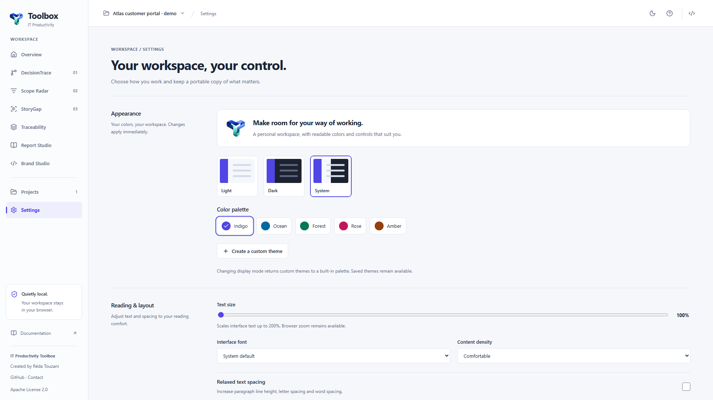

Settings · English · **1920 × 1080**. See the [personalization guide](docs/PERSONALIZATION.md) and [logo source and generation prompt](docs/BRANDING.md).

## Run locally

**Requirements:** Node.js 24 and pnpm 10.18.3, as declared in the repository.

```sh
git clone https://github.com/hrmonic/it-productivity-toolbox.git
cd it-productivity-toolbox
corepack enable
pnpm install --frozen-lockfile
pnpm dev
```

Open the URL printed by Vite. No environment variables, API keys, accounts, or server-side database are needed.

```sh
pnpm build       # TypeScript check and static production bundle
pnpm preview     # Inspect that bundle locally
```

Static hosting guidance and origin-specific storage caveats are in [Deployment](docs/DEPLOYMENT.md). The CI workflow checks the application; it does not deploy it.

## Designed to explain its results

- **Approval stays explicit.** Saving a decision does not accept it. Baselines require a separate freeze action. Accepted/rejected changes are immutable ledger entries.
- **Unknown stays unknown.** Missing effort is not zero. Each baseline uses a single unit. Percentages are unavailable when the initial estimate is zero or required inputs are missing.
- **Simulation stays separate.** Selecting proposals derives a potential scope; it does not change accepted project records.
- **Suggestions stay under your control.** StoryGap provides deterministic review prompts, not AI output or a readiness score. INVEST requires a team conversation.
- **History stays useful.** Decision revisions retain the previous content and explanation. Story revisions retain the original and earlier content. Baseline revisions preserve earlier agreements.

See the [data model and calculation contract](docs/DATA_MODEL.md) for the exact rules and trade-offs.

## Your data stays in this browser

Projects are stored in **IndexedDB through Dexie**, scoped to the current browser and origin. There are no analytics, remote analysis calls, runtime font CDNs, or cloud synchronization. Following an external documentation link opens that website.

**Keep backups.** Clearing site data, browser eviction, or changing the application address can make local records unavailable. IndexedDB and downloaded JSON files are **not encrypted**. Apply your organization's information-handling policy before recording sensitive content.

Full version 2 backups include histories, baseline versions, changes, stories, links, capture drafts, explicit scenario coverage and brand profiles. Version 1 backups remain importable. Imports are limited to 5 MiB and checked for schema and reference integrity before an atomic restore. Existing projects are preserved. Individual report exports are not full restore files.

## A deliberately small architecture

**React 19 · strict TypeScript · Vite 8 · React Router · Dexie · Zod · Radix Dialog · Lucide**

Feature rules, presentation, and storage have separate responsibilities. Native forms and centralized CSS tokens keep the dependency surface focused. Vitest/Testing Library cover domain and component behavior; Playwright/axe exercise real browser journeys and selected accessibility rules.

```text
src/app/                    Application shell, projects, preferences and settings
src/features/decision-trace/ Decision journal, editor, history and rules
src/features/scope-radar/    Baselines, change ledger, calculations and simulation
src/features/story-gap/      Story refinement and deterministic analysis
src/features/traceability/   Typed links and bidirectional navigation
src/features/report-studio/  Shared composition, pagination and local document renderers
src/features/brand-studio/   Validated profiles, raster logos and live previews
src/shared/                 UI primitives, schemas, data boundary and localization
```

The [architecture document](docs/ARCHITECTURE.md) explains the decisions, alternatives and costs. The [PRD](docs/PRD.md) connects features to user needs, acceptance evidence and delivery risks.

## Quality you can inspect

```sh
pnpm check
pnpm exec playwright install chromium
pnpm test:e2e
```

`pnpm check` runs typechecking, lint, formatting checks, unit/component tests and the production build. Browser tests exercise the critical workflows, persistence, restoration, English/French behavior, keyboard focus, mobile navigation, themes and automated accessibility checks. GitHub Actions runs the required checks without `continue-on-error`.

Read [Testing](docs/TESTING.md) and the completed CI runs for actual evidence. No unmeasured coverage percentage, Lighthouse score, complete accessibility certification, or independent security audit is claimed.

## Application Preview

Authentic Chromium viewport captures from the production build with fictional Atlas data. Pixel dimensions equal the configured CSS viewport at `deviceScaleFactor: 1`; these are not full-page crops. See the [dimension/hash manifest](docs/assets/screenshots/manifest.json).

### Responsive — all 9 viewport resolutions

**Desktop** — project overview · 1920 × 1080.

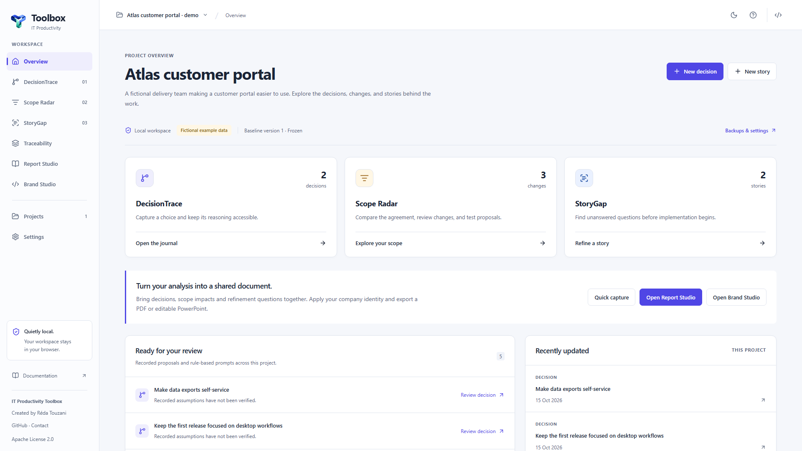

Project overview · English · **1920 × 1080**.

**Ultrawide** — project overview · 3440 × 1440.

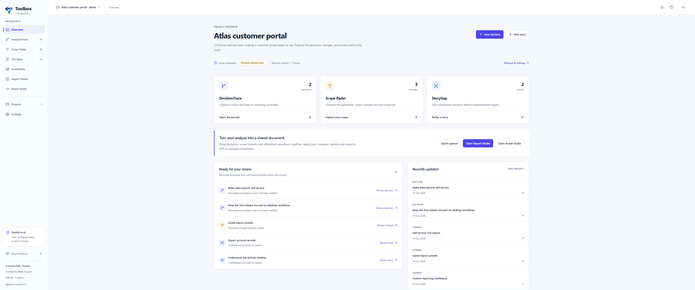

**Laptop** — project overview · 1440 × 900.

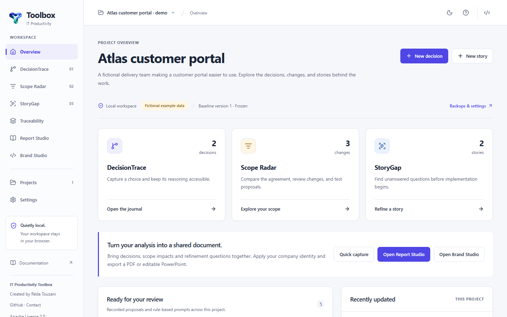

**Compact desktop** — project overview · 1366 × 768.

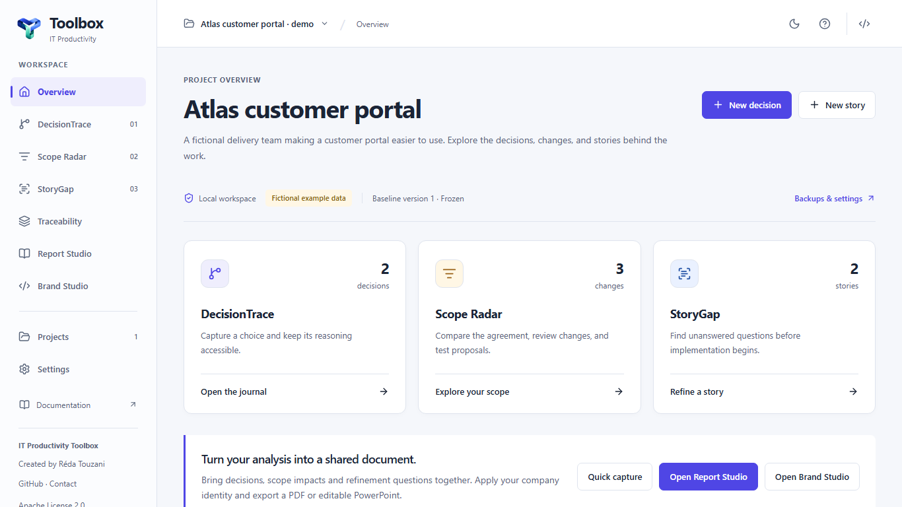

**Tablet** — project overview · 1024 × 768 and 768 × 1024.

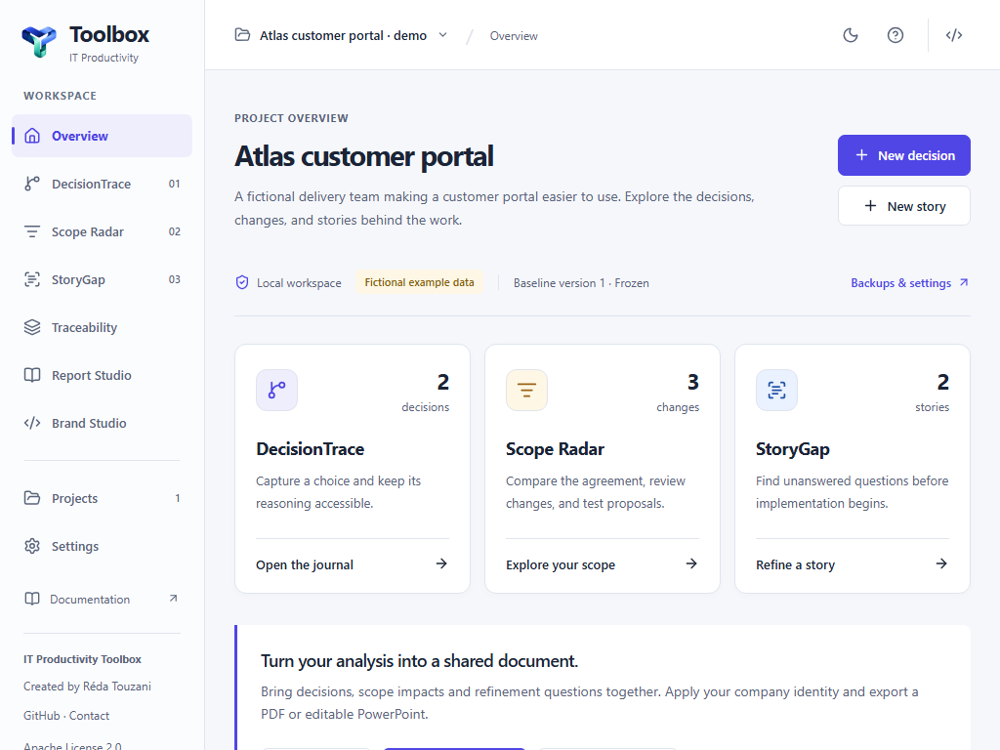
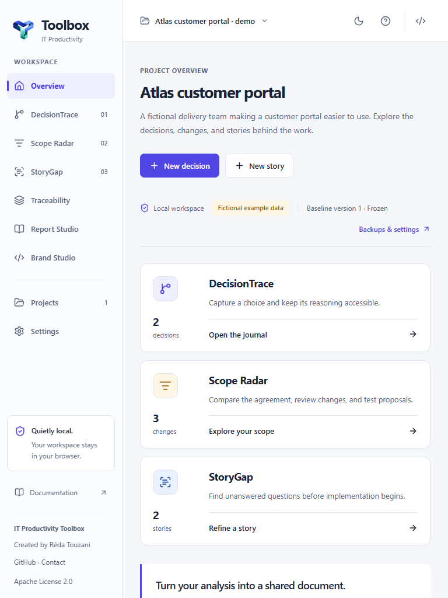

**Mobile** — project overview · 390 × 844, 360 × 800 and 430 × 932.

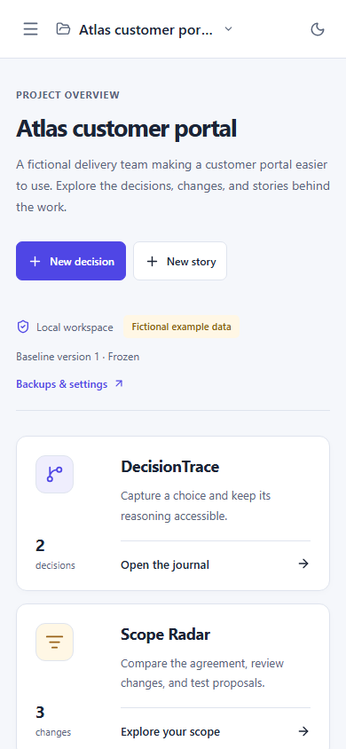
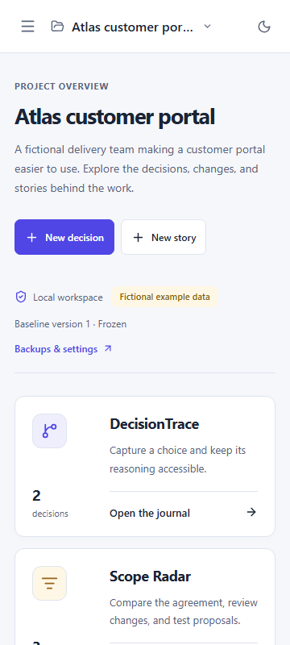
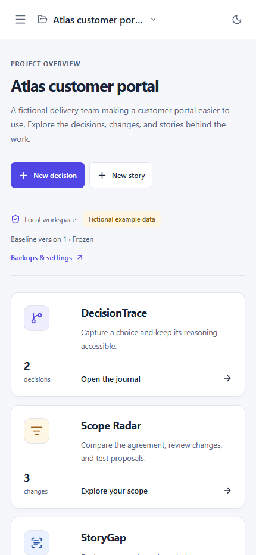

<details>
<summary>DecisionTrace, Scope Radar, StoryGap and the studios</summary>

Decision journal · English · 1920 × 1080.

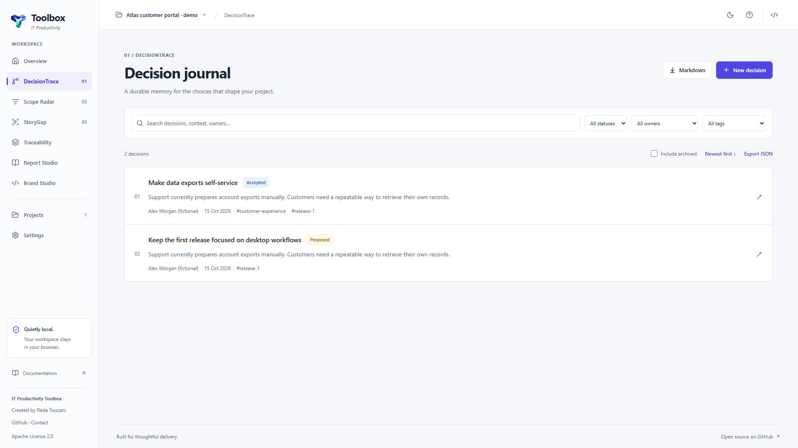

Scope comparison and simulation · English · 1920 × 1080.


Story analysis · English · 1920 × 1080.

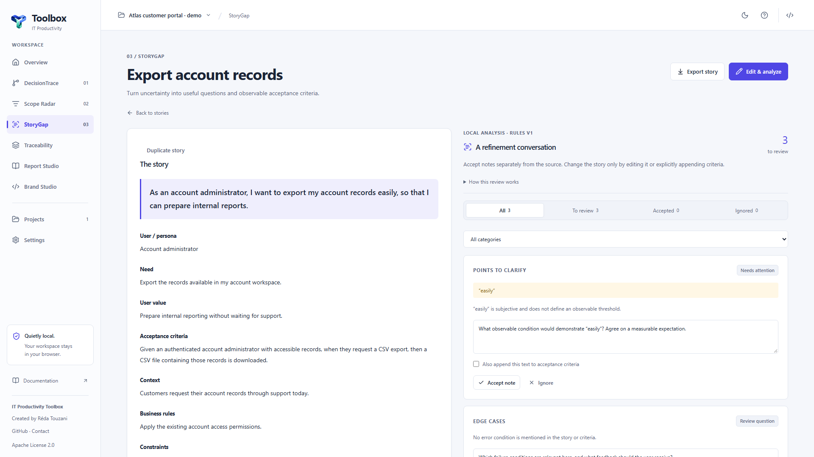

Report Studio · English · 1920 × 1080.

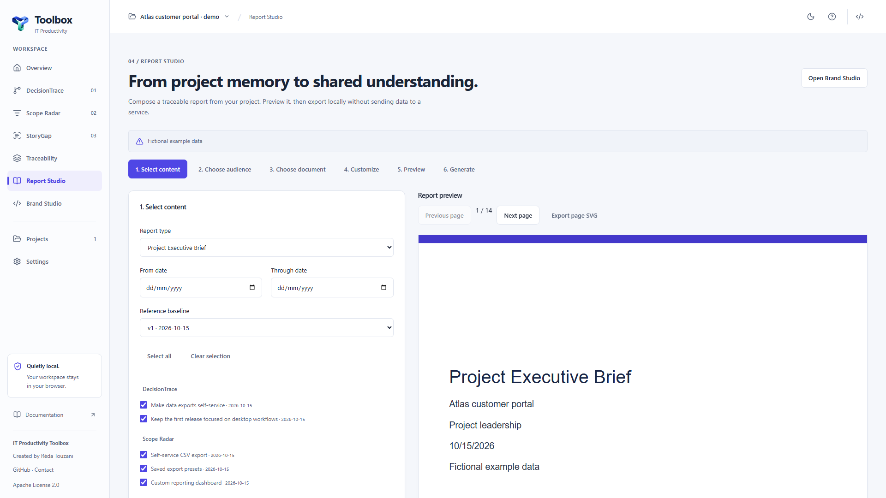

Brand Studio · English · 1920 × 1080.

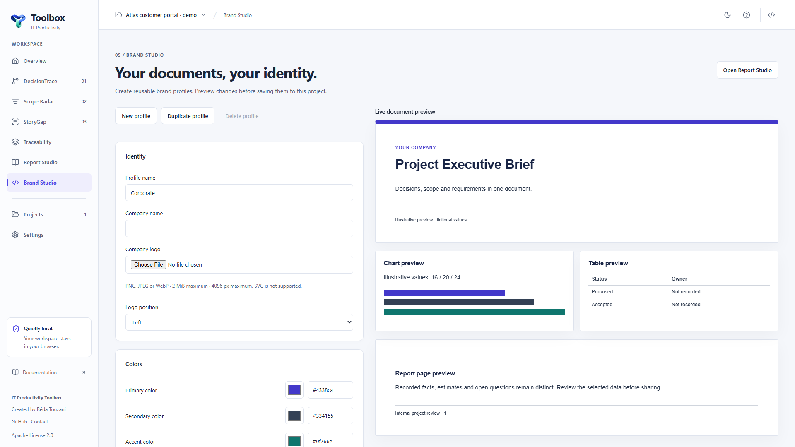

</details>

Run `pnpm test:e2e` successfully before `pnpm screenshots`. Screenshot generation requires matching responsive receipts for the current build.

## Languages and current limits

The interface is available in **English and French** through Settings. Story rules recognize selected English and French formulations. Project content is never translated automatically; demo records remain in English. Structured JSON field names stay stable. Module Markdown/CSV headings follow the interface language; Report Studio has an explicit English/French document language.

The first release has no multi-user collaboration, authentication, encryption, external integrations, schedule predictions, or remote AI. Automated browser validation currently targets Chromium. Draft baselines and proposed changes do not have their own edit histories. Large-workspace performance and a full assistive-technology audit remain future work.

See the [roadmap](docs/ROADMAP.md) for prioritized next work rather than promised dates.

## Contribute or discuss a workflow

Concrete examples of lost decision context, hard-to-explain scope changes, or ambiguous requirements are especially useful. Describe the role, situation, current workaround, and desired outcome in a [GitHub issue](https://github.com/hrmonic/it-productivity-toolbox/issues), using fictional or anonymized content.

[Contribution guide](CONTRIBUTING.md) · [Security policy](SECURITY.md) · [Development handoff](docs/HANDOFF.md)

## License and maintainer

Licensed under the **[Apache License, Version 2.0](LICENSE)**.

Created and maintained by **[Réda Touzani (@hrmonic)](https://github.com/hrmonic)** · [dev@hrmonic.fr](mailto:dev@hrmonic.fr).
