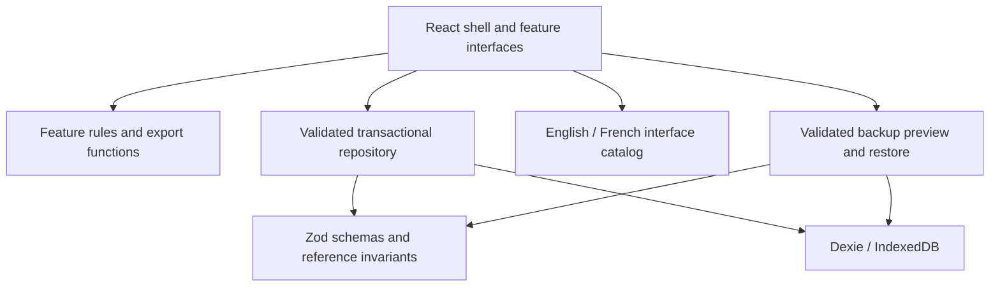

# Architecture

## Runtime and boundaries

A static React application owns navigation and presentation. Feature domain modules own the calculations and rules. A shared data boundary validates and persists project aggregates in IndexedDB through Dexie. Nothing requires a server.



## Source map

```text
src/
  app/                       Shell, routes, projects, settings, brand, preferences
  features/
    decision-trace/          Decision editor, journal, history and rules
    scope-radar/             Baseline/change editors, comparisons and simulation
    story-gap/               Story editor, local analysis and review workflow
    traceability/            Typed links, related-items navigation and register
    report-studio/           Validated composer, shared layout and lazy local renderers
    brand-studio/            Profile editor, raster validation and representative previews
  shared/
    data/                    Database, invariants, backup contract and demo fixtures
    i18n/                    Language preference and French message catalog
    lib/                     Small utilities and localized display formatting
    types/                   Versioned aggregate contracts inferred from Zod
    ui/                      Accessible dialog/form primitives and feedback
tests/e2e/                   Real-browser acceptance and accessibility checks
```

Domain functions do not import React components or storage. Scope comparison and story analysis operate on supplied values; simulation returns a derived result without mutating input. Record factories receive browser-generated UUIDs and timestamps through shared helpers. They are not intended as a server-side authorization boundary.

## Decisions and trade-offs

| Decision                                        | Reason                                                                 | Cost / alternative considered                                 |
| ----------------------------------------------- | ---------------------------------------------------------------------- | ------------------------------------------------------------- |
| Static React + TypeScript + Vite                | Portable deployment and strict contracts without a mandatory service   | No multi-user consistency or server authorization             |
| Hash-based React Router navigation              | Routes work on static hosts without a rewrite service                  | Hash URLs; query parameters live inside the hash              |
| One aggregate per project                       | Atomic edits/imports and straightforward reference checks              | Whole-project reads/writes; revisit for large workspaces      |
| Dexie live queries                              | IndexedDB persistence and updates across tabs                          | Browser availability and eviction remain external constraints |
| Revision check inside a transaction             | Refuse stale-tab writes before they overwrite data                     | Conflicts require the user to reload and reconcile            |
| Zod at read/import/write boundaries             | Fail explicitly on invalid records                                     | Large workspaces incur validation cost                        |
| Native forms + Radix dialogs                    | Browser validation and accessible focus behavior with few dependencies | Complex future forms may justify React Hook Form              |
| Central CSS tokens and native components        | A cohesive identity without a large component dependency stack         | Contributors must follow the documented design tokens         |
| Tables and explicit comparisons                 | Scope figures remain inspectable at record level                       | Recharts/Tailwind/shadcn are unnecessary for this release     |
| Explicit English keys + complete French catalog | One translation surface with testable catalog coverage                 | Source messages and catalog must change together              |
| No AI provider in the runtime                   | Useful behavior without secrets, costs or data disclosure              | Rules cannot understand all business semantics                |

The `StoryAnalyzer` interface is the future provider boundary. Any remote provider needs a separate server-side secret boundary, explicit content consent and clear failure behavior. The shipped `local-rules-v1` provider does not call a model.

## Version compatibility

The lockfile records the installed versions. Node.js 24 is the supported development/CI runtime. TypeScript remains on 5.9 because the installed TypeScript ESLint toolchain declares support below 6.1. Vite 8 uses Rolldown; the build configuration separates React and data vendor groups and loads feature routes on demand. No bundle limit is silenced to hide warnings.

Primary references: [Vite guide](https://vite.dev/guide/), [Dexie React tutorial](https://dexie.org/docs/Tutorial/React), [Vitest guide](https://vitest.dev/guide/), [Rolldown splitting](https://rolldown.rs/reference/OutputOptions.codeSplitting).

## Error and recovery behavior

Writes surface errors without silently replacing form input. Stale updates are refused. Invalid stored projects are preserved and can be downloaded as raw, explicitly unvalidated recovery data. A storage failure is handled by the application error boundary; no automatic database reset is performed. Unexpected records should be investigated using a copy of recovery data, never by overwriting the sole original.

## Reporting and data compatibility checkpoint

Report composition and layout are shared across modules; PDF/PPTX/XLSX dependencies load only at export. They are deliberately separate chunks. Large export-library warnings remain visible; [measured sizes and local timings](evidence/performance.json) document the cost rather than claim a generic performance score. No remote font CDN or external document-generation API is used.

The database is now version 2. Its additive upgrade preserves existing project records and leaves invalid historical rows available for recovery. Backup version 2 protects the new fields from older backup readers while the current parser accepts version 1 and 2. The migration is tested using a real version 1 fixture in fake IndexedDB.

The implementation uses pdf-lib/fontkit (embedded Noto fonts), PptxGenJS (native text/shapes) and ExcelJS (native cells). Scoped overrides select patched `exceljs > uuid` 11.1.1 and `pptxgenjs > image-size` 2.0.3 after the dependency audit. Export round-trips and native Office checks validate the chosen versions. See [Reporting](REPORTING.md), [Design system](DESIGN_SYSTEM.md) and [Internationalization](I18N.md).
