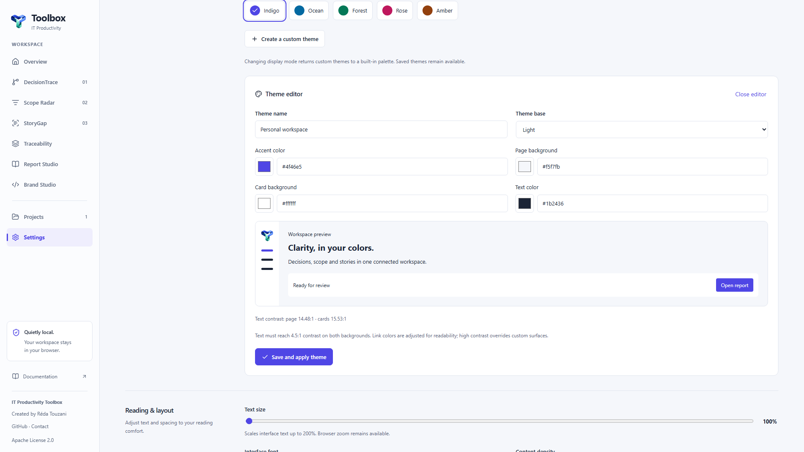
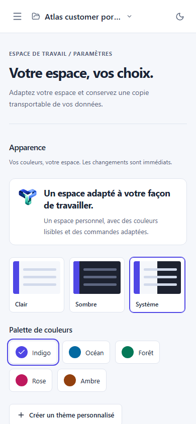

# Workspace personalization

Open **Settings / Paramètres**. Changes apply immediately and persist in this browser when local storage is available. They synchronize across open tabs on the same origin. With storage unavailable, they remain usable for the current session. No account, external font service or network request is needed.

## Appearance and saved themes

Choose light, dark or system mode and one of five built-in palettes: Indigo, Ocean, Forest, Rose and Amber. System mode follows changes to the device’s color scheme. The header’s theme button remains a quick light/dark switch.

**Create a custom theme / Créer un thème personnalisé** opens a preview with four editable colors: accent, page background, card background and text. Both native color pickers and six-digit HEX fields are available. Select a light/dark base, name the theme, and save it. Up to twelve themes can be saved, selected, edited or deleted. Display-mode changes return to a built-in palette while retaining saved custom themes; selecting a saved theme restores its base mode.

Saved themes require at least 4.5:1 contrast for text on page and card backgrounds. The application adjusts derived link colors for legibility and chooses a readable text color on accent buttons. These checks do not certify full accessibility. High-contrast mode overrides custom surfaces and keeps saved themes intact.

Theme editor · English · 1920 × 1080 viewport, scrolled to the editor.

## Reading and accessibility

- Text size: 100–200% in 12.5% increments, using relative font sizes throughout the interface. Browser zoom remains independent.
- Fonts: system, readable sans serif, serif or monospace, using locally available system fonts.
- Density: comfortable or compact content padding. Larger controls remain independently available.
- Relaxed spacing: more line height, letter spacing and word spacing for reading content.
- High contrast: standard, high or follow the device’s contrast preference. Windows forced-colors rendering is respected separately.
- Reduced motion: follow the device or explicitly reduce animations. A device request for reduced motion is never overridden.
- Underlined links and stronger visible keyboard focus can be enabled independently.

The preference controls use native buttons, selects, ranges and checkboxes with keyboard support. Automated Chromium tests cover the settings and representative routes at enlarged text sizes. Manual assistive technology, real devices and additional browser engines remain further validation work.

## Portable preferences

**Export settings** downloads versioned JSON containing interface preferences and saved custom themes. **Import settings** accepts files up to 32 KiB, validates the complete structure, theme references, colors, contrast, scale and identifiers, then applies all settings atomically. Invalid files preserve existing settings.

**Reset preferences** restores default appearance and accessibility choices while retaining saved custom themes. Delete individual themes explicitly if no longer needed. Project records, full project backups, language selection and document brand profiles are separate and unaffected. Preferences are stored under `toolbox.appearance`; the legacy `toolbox.theme` value is migrated on first use and maintained for compatibility.

## Paramètres en français

Dans **Paramètres**, choisissez vos couleurs, créez un thème personnel, agrandissez le texte et adaptez les options d’accessibilité. Les changements sont immédiats et restent locaux. L’export des réglages transporte les thèmes et préférences ; la sauvegarde des projets conserve les données métier. Réinitialiser les préférences garde les thèmes enregistrés et ne supprime aucun projet.

Paramètres · Français · viewport 390 × 844.
