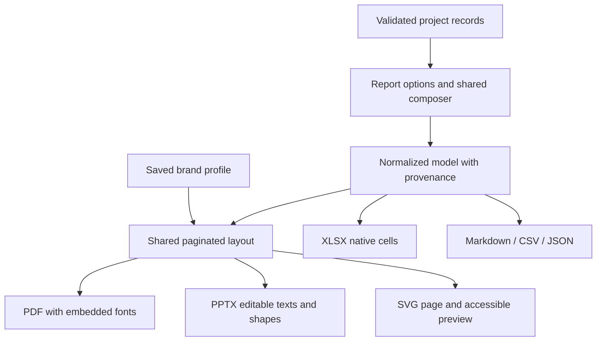

# Report Studio and Brand Studio

The studios turn recorded project information into local documents. They do not approve decisions, commit simulated proposals, infer business rules or send content to a remote generator.

## Prepare a review

1. Select a project. In DecisionTrace, **Prepare Decision Brief** selects that decision; StoryGap’s **Prepare Refinement Pack** selects that story. The general Report Studio entry starts with project records selected.
2. **Select content:** choose Decision Report, Scope Impact Report, Story Refinement Report, Project Executive Brief or Steering Committee Presentation. Select records, dates and the relevant baseline. Decisions/changes use their recorded date; stories use their last-update date. Records of other module types are omitted by the report type.
3. **Choose audience:** development team, Product Owner, project leadership, steering committee or business stakeholders. The audience is printed on the cover. Summary omits supporting detail; detailed reports retain alternatives, original text, scenario coverage and recorded constraints. Steering committee reports initially select summary detail. No audience-specific claim is fabricated.
4. **Choose document:** PDF, editable PowerPoint, XLSX, Markdown, JSON or CSV. Choose English or French headings; user content is preserved verbatim in its original language.
5. **Customize:** select a saved brand profile, edit the title/introduction, include or exclude sections and change their order. Empty sections are omitted.
6. **Preview:** inspect the pages and accessible text view. **Preview actual PDF** creates the real PDF, displays it in the browser and offers a separate tab. The layout preview uses conservative measurements; actual PDF pagination uses embedded font measurements. Review the real output before sharing.
7. **Generate:** download the selected format. Progress is reported and generation can be cancelled at processing checkpoints. Cancellation does not modify the project.

The assistant has six numbered steps; the list above separates the project entry point from those steps.

## Calculation and provenance contract

- The composer validates project schemas, references and report options before producing its model.
- Every entry carries source IDs. Metadata includes project ID/revision, generation date, selection, reference period and explicit fictional status. The executive summary references the project aggregate; record entries reference their source objects.
- Scope totals reuse `calculateScope`. A selected baseline snapshot includes **all accepted changes through the end date**. The start date and record selection filter the change register, not the snapshot. This context is printed in the report. A baseline after the end date is omitted.
- Missing estimates stay unavailable. Effort units are explicit and no budget or schedule forecast is manufactured. The comparison chart appears only when initial/current totals exist. Bars are vector shapes in PDF and editable shapes in PowerPoint.
- Direct and indirect relationships are review paths, not evidence that a consequence will occur. Only selected endpoints are included in the report’s relationship section.
- Open questions exclude accepted and ignored review prompts. Accepted notes remain user-authored notes; complete scenario links are not evidence of test execution or business correctness.
- JSON exports the normalized **report model**, not a restorable project. Restore only the versioned backup from Settings.

## Reusable brand profiles

Profiles belong to the active project. Create, save, reload, duplicate or delete them in Brand Studio. They travel with full project backups and receive new IDs on restoration. Editing a profile previews the draft; Report Studio uses saved profiles. Deleting a profile does not alter previously downloaded documents.

Available controls:

- Profile/company name, optional logo, left/right logo placement, header and footer.
- Main, secondary, accent, heading, body-text and page-background colors.
- Native visual color picker, validated six-digit HEX input, palette, recent in-session colors and a corporate preset.
- Body/heading contrast checks against the page background, with a readable-color suggestion. The technology cover automatically selects light or dark text against its primary color.
- Separate heading, subtitle and body fonts: Arial, Georgia and Courier New. PDF embeds OFL-licensed Noto Sans/Serif/Mono substitutes and falls back to Noto Mono for supported symbols. PPTX requests the selected system font; recipients’ software can substitute an unavailable font.
- Minimal Corporate, Executive, Modern Technology, Editorial and Data Focused cover compositions. They differ in placement, bars, title scale or filled cover treatment. Content-page layout remains shared for maintainability; these are not five independent slide-layout libraries.
- Representative cover, chart, table and report-page previews. Brand Studio’s sample values are explicitly illustrative, not selected project measurements. Report Studio previews the real selected content.

Logos must be real PNG/JPEG/WebP files, at most 2 MiB and 4096 pixels per side. Magic bytes and dimensions are read before decoding. The decoded image is resized proportionally to at most 640 pixels, converted to PNG and bounded to 600,000 data-URL characters. Unsupported, corrupt or oversized images are refused without replacing the existing logo. SVG logo upload is unsupported; SVG page export is a separate, escaped document output.

## Renderer architecture

`model.ts` owns selection, narration and source IDs. `layout.ts` wraps text and paginates without silently truncating body content. `renderers.ts` lazy-loads PDF/PPTX/XLSX libraries. Exports do not modify source records. Blob URLs are revoked after downloads or preview replacement/unmount. Font requests target bundled application files only.

PDF uses portrait proportions, editable PPTX uses 16:9, and XLSX has native cells, wrapped text, a frozen heading and a filter. Long text is split across spreadsheet rows rather than exceeding Excel’s cell character limit. CSV formula-looking strings are neutralized. Page generation stops at 500 pages with an explicit instruction to reduce the selection or use structured output. Fonts without the required characters cause an explicit error rather than dropping content; full multilingual font coverage is not claimed.

## Validation and boundaries

Browser acceptance generates and reopens every format. Tests inspect PDF structure/title/images, PPTX slide XML/native text/colors/media, XLSX cells, and Markdown/JSON/CSV content. French PDF/PPTX exports are exercised separately. Native PowerPoint rendering and text-box measurements supplement structural tests on the local Windows host; they are not part of Linux CI.

See [Testing](TESTING.md), [validation receipt](VALIDATION.md) and [handoff](HANDOFF.md) for the actual measured checkpoint. The preview is not a substitute for document review. Reports are not tagged PDF/UA documents, and native Office rendering can vary with installed fonts. Print-quality output for every font, script, project size or presentation application is not certified.
